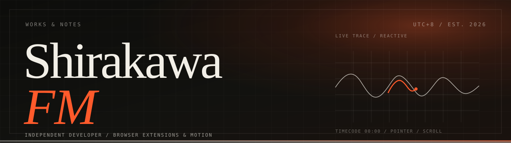
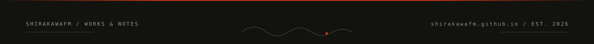

 

  

---

## 👋 你好，我是 ShirakawaFM

独立开发者，住在 **UTC+8**。写浏览器扩展、影像工具，和一些没有 deadline 的 Minecraft 模组。

我喜欢把复杂的东西做小：一个只申请三个权限的 Chrome 扩展、一条从打 tag 到 Release 的自动化流水线、一个不用框架的个人网站。**把东西做出来不难，难的是做完之后还能把它解释清楚。**

这个 GitHub 主要放正在维护的项目与实验。我的写作、设计笔记和完整作品索引在 **[shirakawafm.github.io](https://shirakawafm.github.io)**。

<table>
  <tr>
    <td width="33%" valign="top">
      <h3>🚀 现在</h3>
      <ul>
        <li><b>douyin-auto-hd</b> 抖音网页版自动最高画质</li>
        <li><b>FM-S-Blogs</b> Next.js 写作系统</li>
        <li><b>Video Lab</b> Remotion + FFmpeg 影像实验</li>
        <li><b>个人站点</b> 手写 HTML / CSS / JS</li>
      </ul>
    </td>
    <td width="33%" valign="top">
      <h3>🧠 在意的事</h3>
      <ul>
        <li>界面的秩序：字号、字距、留白</li>
        <li>工具的手感：速度、键盘、报错提示</li>
        <li>影像的节奏：剪辑点、声音、字幕</li>
        <li>代码的可解释性：为什么这样做</li>
      </ul>
    </td>
    <td width="33%" valign="top">
      <h3>🌱 最近在学</h3>
      <ul>
        <li>高级前端动效与浏览器渲染</li>
        <li>AI Agent 与自动化工作流</li>
        <li>Remotion 程序化视频</li>
        <li>排版与字体设计</li>
      </ul>
    </td>
  </tr>
</table>

## 🛠️ 技术栈

<picture>
  <source media="(prefers-color-scheme: dark)" srcset="https://skillicons.dev/icons?i=ts,js,python,java,html,css,nextjs,nodejs,git,docker,github,vscode&amp;theme=dark&amp;perline=6" />
  
</picture>

  

## 📊 GitHub 数据

<table>
  <tr>
    <td>
      
    </td>
    <td>
      
    </td>
  </tr>
</table>

## 🧩 代表项目

<table>
  <tr>
    <td width="50%">
      
    </td>
    <td width="50%">
      
    </td>
  </tr>
</table>

**[douyin-auto-hd](https://github.com/ShirakawaFM/douyin-auto-hd)** — 最小权限的 Chrome 扩展，访问抖音网页版时自动切到当前可用的最高画质。22 次迭代，大部分时间在删掉错误的假设。  
**[FM-S-Blogs](https://github.com/ShirakawaFM/FM-S-Blogs)** — 带本地后台的 Next.js 写作系统：Markdown、草稿、图床、一键部署。  
**[ShirakawaFM.github.io](https://github.com/ShirakawaFM/ShirakawaFM.github.io)** — 手写的个人站点：一份 CSS、两份 JS、自托管字体，无框架、无第三方请求。  
**Video Lab** — Remotion + FFmpeg 的影像实验：脚本、分镜、配音、字幕、渲染。还在实验阶段。

## ✍️ 最近写作

| 日期 | 文章 | 主题 |
| --- | --- | --- |
| 2026-10-25 | [最小权限的代价：给抖音网页版做画质自动化的 22 次迭代](https://shirakawafm.github.io/writing/minimal-permissions.html) | 工程 |
| 2026-10-25 | [让发版自己发生：一个浏览器扩展的 GitHub Actions 流水线](https://shirakawafm.github.io/writing/release-pipeline.html) | 发布 |
| 2026-10-25 | [把博客从模板里救出来：一次反 AI 味的设计重写](https://shirakawafm.github.io/writing/escape-the-template.html) | 设计 |

## 🐍 贡献图

<picture>
  <source media="(prefers-color-scheme: dark)" srcset="https://raw.githubusercontent.com/ShirakawaFM/ShirakawaFM.github.io/output/github-snake-dark.svg?v=2" />
  
</picture>

由 GitHub Actions 每 12 小时生成一次。

## 💭 我怎么做东西

1. **先问能不能不要。** 能少一个依赖、少一个权限、少一层抽象，就先减掉。
2. **假设要能被验证。** 动手前先想清楚：如果这个判断错了，我多久会知道。
3. **动效服务于理解。** 只动 `transform` 和 `opacity`，不劫持滚动，尊重 `prefers-reduced-motion`。
4. **写下来。** 决定、代价、失败的原因都值得留档，否则下次会再犯一遍。

> 把复杂的东西，做得安静。

## 📫 联系我

<b>English intro</b>

 

**ShirakawaFM** — independent developer in UTC+8. I build browser extensions, video tooling and the
occasional Minecraft mod, usually by removing things rather than adding them.

- **[douyin-auto-hd](https://github.com/ShirakawaFM/douyin-auto-hd)** — a minimal-permission Chrome extension that switches Douyin web videos to the highest available quality.
- **[FM-S-Blogs](https://github.com/ShirakawaFM/FM-S-Blogs)** — a Next.js writing system with a local admin panel, Markdown editing and one-click deployment.
- **[shirakawafm.github.io](https://shirakawafm.github.io)** — a hand-written personal site: no framework, no build step, no third-party requests.

I care about quiet tools: fast, predictable, and honest about their limits. More writing at
[shirakawafm.github.io/writing](https://shirakawafm.github.io/writing/).

---

这个仓库托管 <a href="https://shirakawafm.github.io">shirakawafm.github.io</a> 的源码：手写 HTML / CSS / JS，无框架、无构建。站点说明见 <a href="https://shirakawafm.github.io/about/">关于页</a>。

